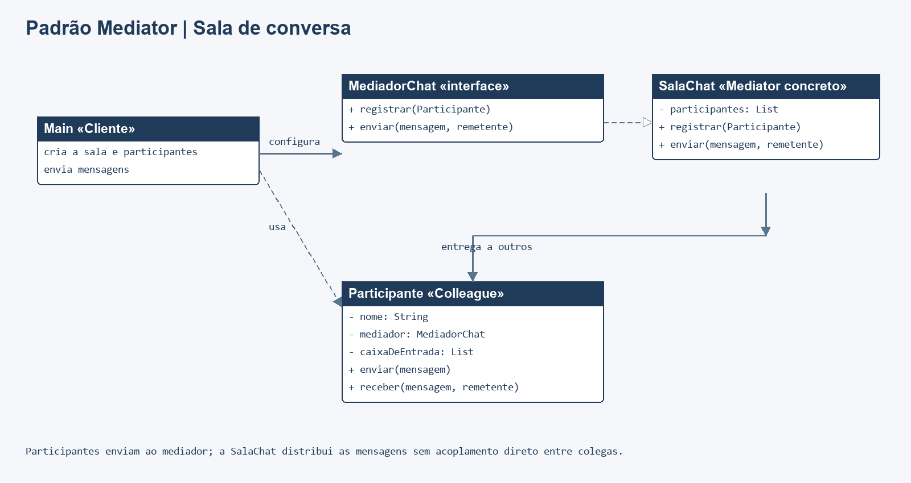

# Padrão Mediator em Java

Aplicação de console que simula uma sala de conversa. Os participantes enviam mensagens ao mediador, que as distribui aos demais membros da sala. Os participantes não precisam conhecer uns aos outros.

## Executar

Requer JDK 8 ou superior, sem dependências externas. Na raiz do repositório:

```sh
mkdir out
javac -encoding UTF-8 -d out src/*.java tests/*.java
java -cp out Main
java -cp out MediatorTest
```

Se `out` já existir, pule o `mkdir`. Os testes usam verificações explícitas; falhas lançam `AssertionError` e terminam com código de erro.

## Participantes

| Papel | Classe/interface |
| --- | --- |
| Mediator | `MediadorChat` |
| Mediator concreto | `SalaChat` |
| Colleague | `Participante` |
| Cliente | `Main` |

`SalaChat` mantém os participantes registrados e coordena a entrega das mensagens. Uma mensagem é enviada a todos os membros, exceto ao remetente. O cadastro duplicado é ignorado, e somente participantes registrados podem enviar pela sala.

## Diagrama de classes



Fonte editável: [diagrama.mmd](docs/diagrama.mmd).

## Testes

`tests/MediatorTest.java` cobre entrega para os outros participantes, exclusão do remetente, múltiplas mensagens, registro duplicado, envio por participante não registrado, validação de dados e proteção da caixa de entrada.
